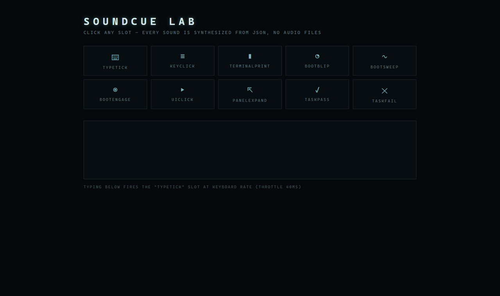

# SoundCue

**Config-driven Web Audio UI sound engine — describe sounds as JSON, ship zero audio assets, swap the whole soundscape at runtime.**

[](./LICENSE)
[](./.github/workflows/ci.yml)

[中文文档](./README.zh-CN.md)

---

Most UI sound solutions hand you a bag of `.mp3` files or a game-engine-grade
library. SoundCue takes the other path: **every sound is data**. An oscillator
burst here, a filtered noise burst there, a throttle for type-rate sounds —
described in JSON, synthesized on the fly, and remappable at runtime via named
slots (`typeTick`, `keyClick`, `uiClick`, ...).
<div align="center">
  
</div>


```tsx
import { useSoundcue, playUiClick } from "soundcue";

function App() {
  useSoundcue(); // installs the early audio unlock on first gesture
  return <button onClick={() => playUiClick()}>Click</button>;
}
```

## Features

- **Zero audio assets** — the default pack is pure synthesis (oscillator/noise layers, frequency slides, biquad filters). Ship no `.mp3` files at all.
- **Config-driven** — named slots map to presets; fetch a JSON config at runtime to re-skin every sound without touching code. Optional sample-file playback is supported too.
- **Mix-safe** — one master bus with a dynamics compressor, so cranking the volume never clips stacked sounds.
- **Zero dependencies** — core has no runtime deps; the React entry is a thin peer.
- **SSR-safe** — every browser-API access is guarded; on the server everything is a silent no-op.

## Install

```bash
npm install soundcue
```

| Stack | Import |
| --- | --- |
| React / Next.js | `import { useSoundcue } from "soundcue"` |
| Any framework / plain JS | `import { createSoundcue } from "soundcue/core"` |

## API

### `createSoundcue(options?) → Soundcue`

Isolated engine instance.

| Option | Type | Description |
| --- | --- | --- |
| `config` | `SoundConfig` | Initial pack (defaults to the built-in synth pack) |
| `configUrl` | `string` | JSON config fetched once on first use; overrides `config` on success |

| Method | Description |
| --- | --- |
| `unlock()` | Resume the AudioContext — call inside a user gesture, as early as possible |
| `play(slot)` | Play the preset bound to a slot (no-op before unlock / outside browsers) |
| `setMasterVolume(v)` | Global volume multiplier; `<= 0` mutes |
| `setConfig(config)` | Replace slots + presets at runtime |
| `getConfig()` | Snapshot of the current config |

### Default slot names

`typeTick` · `keyClick` · `terminalPrint` · `bootBlip` · `bootSweep` ·
`bootEngage` · `uiClick` · `panelExpand` · `taskPass` · `taskFail`

The framework-free entry (`soundcue/core`) also exports semantic helpers:
`playTypeTick()`, `playKeyClick()`, `playUiClick()`, `playBootSweep()`, ...

### Config shape

```ts
{
  masterVolume: 1,
  slots: { uiClick: "C2" },
  presets: {
    C2: {
      throttle: 0,
      layers: [
        { kind: "osc", wave: "sine", freq: 520, freqEnd: 760, dur: 0.06, gain: 0.05, attack: 0.004 },
      ],
    },
  },
}
```

Layers are `kind: "osc" | "noise"` bursts with `freq`/`freqEnd` slides,
optional `filter: { type, freq, freqEnd, q }`, `at` offsets for multi-tick
sounds, and presets may alternatively point at a `sample` URL (with offset,
duration, gain and playback-rate jitter). See [`src/core/engine.ts`](./src/core/engine.ts)
for the fully documented schema.

## Origin

Extracted from the HackerEnglish project, where it drives the whole
workstation soundscape (boot sequence, mechanical keyboard, terminal, task
feedback). See [`docs/PORTING.md`](./docs/PORTING.md).

## License

[MIT](./LICENSE).
